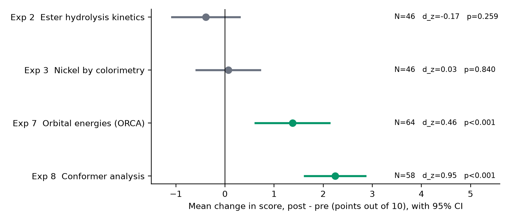

# A Deterministic-First AI Tutor for Chemistry Laboratory Learning: Design and Classroom Evaluation Across Four Experiments

**Adhyan Jain**¹, **Aayush Jaiswal**¹, **Satyam Bhalotia**¹, **Jagalingam P**¹\*

¹ [School / Department — TO CONFIRM], Vellore Institute of Technology, [Campus — TO CONFIRM], India

\* Corresponding author: Dr. Jagalingam P, jagalingam.p@vit.ac.in

Adhyan Jain: adhyan.jain2024@vitstudent.ac.in · Aayush Jaiswal: aayush.jaiswal2024@vitstudent.ac.in · Satyam Bhalotia: satyam.bhalotia2024@vitstudent.ac.in

*Manuscript prepared for the Journal of Science Education and Technology (Springer). First draft — items marked [TO CONFIRM] need author input before submission.*

---

## Abstract

Large language models can answer chemistry questions fluently, but in a laboratory course they are hard to trust: they may state a wrong value, hand over the answer a student is meant to work out, or answer without reference to the course's own manual. We describe Catalyst, a tutor for an undergraduate Applied Chemistry Laboratory course in which a language model never decides anything. Correctness checks, expected values and the classification of why a result is wrong are computed by deterministic code from the manual's formulas; safety and scope triage are rule-based; and the model only phrases an already-made decision, grounded in a retrieved passage, in one generation per message, behind an answer gate that removes any number the student has not already seen. We deployed the tutor in a single class (67 enrolled students) over three lab sessions covering four experiments and evaluated it with a single-group pre-test/post-test design. Students sent 2,545 prompts (median 5 words). Mean scores rose significantly in Experiment 7 (+1.38 of 10, 95% CI 0.62–2.13, d_z = 0.46, N = 64) and Experiment 8 (+2.24, 1.62–2.86, d_z = 0.95, N = 58) but not in Experiment 2 (−0.39, d_z = −0.17) or Experiment 3 (+0.07, d_z = 0.03; N = 46 each). Exploratory analyses associated prompt volume with gain after adjusting for pre-test score in Experiment 2, and borderline in Experiment 3. Because the design has no control group and the Experiment 2/3 tests were close together, we do not claim the tutor caused any change. We report the design, usage, failure modes (including a retrieval gap affecting about 18% of Experiment 2/3 questions) and lessons for deploying grounded AI tutors in laboratory courses.

**Keywords:** AI tutor · chemistry laboratory education · retrieval-augmented generation · deterministic verification · pre-test/post-test evaluation · undergraduate chemistry

---

## 1 Introduction

Laboratory work is one of the distinctive parts of a chemistry degree, yet it is an expensive and uneven place to learn. Hofstein and Lunetta (2004) argued that the laboratory's educational promise depends on how well activities are designed and supported, and Reid and Shah (2007) noted that students often carry out procedures without understanding what the procedure is for. A student who makes a conceptual or procedural error often learns of it only when the report is marked, days later, when the error can no longer be acted on. One instructor cannot review each submission for *why* it is wrong across many sections.

Large language models (LLMs) appear to fill this gap, and the early evidence on AI tutoring is mixed. A randomised trial in undergraduate physics found that an AI tutor built on pedagogical principles outperformed in-class active learning on learning gains (Kestin et al., 2025). A field experiment in high-school mathematics found that unrestricted access to a general-purpose chatbot improved practice performance but harmed later unassisted performance, whereas a version with guardrails largely avoided the harm (Bastani et al., 2025). Language models also produce confident statements that are not supported by their sources (Ji et al., 2023), which in a chemistry laboratory can mean a wrong concentration, a wrong end-point or an unsafe suggestion.

A second concern is specific to practical work. Gestiardi and Subanji (2026) review the risk that AI use deskills laboratory practice by eroding embodied and tacit knowledge. A tutor that does the thinking, or that substitutes for handling apparatus, would sharpen that risk.

This paper describes a tutor designed around those concerns and reports its first classroom evaluation. Catalyst is built on one architectural rule: **no language model decides anything**. Every pass/fail determination, expected value and classification of a student's error is computed by deterministic code from the course manual's own formulas; models are used only to phrase a conclusion that has already been reached, grounded in a retrieved passage of the manual. The tutor was deployed for the VIT course BACHY105 (Applied Chemistry Laboratory) and was used by students who in some sessions had only a phone and no apparatus, so it defaults to explaining theory and offers the practical only as an authored overview.

We ask three questions:

- **RQ1 (use).** How did students use the tutor, and how did the system behave under real class load?
- **RQ2 (scores).** Did scores change between a pre-test and a post-test taken around the tutor-supported session in each of four experiments?
- **RQ3 (exploratory).** Is the amount of tutor use associated with score change?

Our contributions are (i) a design that makes an LLM tutor auditable by confining the model to phrasing; (ii) a description of the controls that implement that rule in practice; and (iii) an evaluation that reports a mixed result honestly, including a retrieval failure mode that appeared only at scale.

---

## 2 Background

**Laboratory learning in chemistry.** Chemistry understanding is often described as moving between macroscopic observations, submicroscopic models and symbolic representations (Johnstone, 1991). Laboratory sessions are where the three meet, which is also why they are demanding: a student must hold the procedure, the observation and the theory in mind together. Reid and Shah (2007) discuss how the aims of university laboratory work can be lost when students follow instructions without engaging with purpose. A tutor aimed at the laboratory should therefore support the reasoning behind the procedure rather than replace the student's own work.

**Intelligent tutoring systems.** Meta-analyses of intelligent tutoring systems (ITS) report positive average effects on learning relative to non-ITS instruction (Ma et al., 2014; Kulik & Fletcher, 2016), and VanLehn (2011) found that step-based tutoring can approach the effectiveness of human tutoring. Classical ITS relied on authored domain models and deterministic checking of student steps, which is the tradition Catalyst's deterministic core inherits; the new element is a conversational surface supplied by a language model.

**AI in higher education and LLM tutoring.** Reviews of AI in higher education note rapid growth with limited attention to pedagogy and ethics (Zawacki-Richter et al., 2019), and Kasneci et al. (2023) set out both opportunities and risks of LLMs for education, including reliability and over-reliance. Whether a tutor helps depends heavily on how it constrains the model (Bastani et al., 2025; Kestin et al., 2025). Our design takes the constraint to its limit: the model is not asked to judge correctness at all.

**Active engagement and testing.** The ICAP framework holds that learning improves as students move from passive to active, constructive and interactive engagement (Chi & Wylie, 2014). The tutor's authored Socratic follow-ups aim at constructive engagement. Retrieval practice itself improves later retention (Karpicke & Roediger, 2008), which matters for how we read a post-test taken shortly after a pre-test (Section 7).

---

## 3 The Catalyst tutor

Figure 1 summarises the message path. The system has two modes over one three-tier core. In **diagnostic mode**, a finished record is submitted; Tier 1 recomputes the expected result from the student's own inputs using the manual's formulas and decides pass/fail; if the result is wrong, numeric signature detection and a curated library of known non-numeric mistakes (Tier 2) try to explain why; and only if neither matches does the case escalate to staff (Tier 3). In **Socratic mode**, one step is shown at a time and Tier 1 verifies only the current step against the student's own earlier data, with a hint ladder that moves from vague to specific and names the issue but never the number.

### 3.1 The architectural rule and where the model sits

Models are used for exactly one job: phrasing a conclusion already reached, grounded in a passage retrieved from the course manual and authored notes. The model never computes an expected value, never judges whether a student's step or result is correct, and never classifies why a result is wrong. This is enforced by construction rather than by instruction. The object marshalled into a Socratic prompt has no field that could carry the final answer, and a start-up and test-suite check pins its field set; the model therefore never holds the value and cannot be talked into revealing it.

### 3.2 The answer gate

Every student-facing message leaves through one function. In Socratic mode it removes any number the student has not already seen in the conversation, so a hint that introduces a new number is not delivered as written. In diagnostic mode, where the student has finished and the value is theirs to see, the recomputed value passes through and the text is still sanitised. Using one outbound door for both modes makes "the gate is the single choke point" a property of the code.

### 3.3 Deterministic triage and safety

Four message intents are handled before any model call and receive fixed, authored responses: an injury report, a question about whether something is safe to do, a student in real difficulty, and a clearly off-scope request. The first three are written to an audit log. This was made deterministic because a model-dependent safety path failed in testing when the inference backend was unavailable: a student reporting an acid spill received an irrelevant reply about checking a label. The classifier favours precision over recall, since a missed off-scope question costs nothing while a false refusal blocks a real chemistry question.

### 3.4 Theory-first mode for phone-only classes

Some students attend with only a phone and no apparatus, computer or software. For these classes the tutor defaults to theory: a theory question receives a grounded answer plus one authored Socratic follow-up whose reply is graded by pattern matching; the practical is shown only as an authored overview when explicitly requested, saying plainly that nothing in it needs to be done on the phone; and a "guide me through the key ideas" request opens a short authored conceptual session. Detection of theory, procedure and exit is rule-based. Every authored student-facing question must pass a "phone-safe" test so that it never requires external software or a second screen. This design choice is also our response to the deskilling concern: the tutor explains the chemistry and does not stand in for handling apparatus.

### 3.5 Retrieval, budget and fallback

Questions are answered from a hybrid lexical index over the course manual and authored background notes. Each message costs at most one model generation; safety, distress and off-scope triage cost none. Retries have a single owner with a bounded budget, concurrency is bounded per process, and a request that cannot obtain a model slot, or whose model call fails, receives an extractive fallback assembled from the retrieved passage rather than waiting. The deployment recorded each reply's source, status, latency and retry/fallback flags, which is the basis of the usage results in Section 5.

### 3.6 What was and was not deterministic in the study

Two experiments in the study received special handling in the software: Experiment 8 has deterministic energy-ordering checks, and Experiment 7 has deterministic sanity checks on reported energies and orbital values. In the class sessions analysed here, however, students interacted mainly through the theory and question-answering paths (Section 5.1). The scoring results therefore reflect that mode of use, not the full diagnostic pipeline. The evaluation reported here is not an evaluation of the diagnostic mode on submitted results.

---

## 4 Method

### 4.1 Context and participants

The study took place in BACHY105, an Applied Chemistry Laboratory course at Vellore Institute of Technology, in one class (SJT-102) of 67 enrolled students [TO CONFIRM: programme, year, and whether all students are first-year]. Three lab sessions were run with the tutor: Experiment 7 (orbital energies computed with Gabedit/ORCA) on 8 October 2026; Experiment 8 (conformer analysis) on 13 October 2026; and a combined session on 29 October 2026 (16:00–17:30 IST) covering Experiment 2 (kinetics of acid-catalysed ester hydrolysis) and Experiment 3 (nickel estimation by smartphone colorimetry), with the time shared equally (45 minutes each). An earlier demonstration session (7 October 2026) is excluded from all analyses.

### 4.2 Design

For each experiment we used a single-group pre-test/post-test design. There was no control group and no random assignment: all students had access to the tutor, and tutor use was voluntary. [TO CONFIRM: for Experiments 7 and 8, when exactly the pre-test and post-test were administered relative to the session, and whether the post-test items differed from the pre-test items.]

### 4.3 Instruments

*Experiments 7 and 8.* Pre-test and post-test scores were recorded out of 10 on a shared spreadsheet, one tab per experiment [TO CONFIRM: number and type of items, and the source of the items].

*Experiments 2 and 3.* A single 20-item multiple-choice quiz was delivered as an online form before the session and again after it, with different items in the two administrations. Items 1–10 assess Experiment 2 and items 11–20 assess Experiment 3, so each experiment is scored out of 10. The form export contained each student's answers and total score but not per-question marks or the answer key. We therefore derived the key as the assignment of one option per question that reproduces every student's total exactly, solved as an integer programme. A unique solution existed for both tests (59 and 51 submissions respectively), and the derived answers were consistent with the course material on inspection [TO CONFIRM: in particular pre-test item 15, the oxidising agent for the Ni–DMG complex, keyed as K₃[Fe(CN)₆]]. The derived key is provided with the supplementary materials, and we ask the course team to confirm it against the original key before submission [TO CONFIRM]. Per-experiment scores are the number of correct answers among that experiment's ten items.

### 4.4 Data preparation

Students were matched across tests by register number. In the Experiment 2/3 forms, some students typed their name in the register-number field and the reverse, or used a letter O for a zero; these were repaired where the true identifier was recoverable, and one submission with no recoverable identifier was excluded. Where a student submitted a test more than once, the first submission was kept (four repeat pre-test and two repeat post-test submissions). Students missing either test were excluded from that experiment's analysis. Paired samples were N = 64 (Experiment 7; 3 of 67 students missing a test), N = 58 (Experiment 8; 9 missing), and N = 46 for each of Experiments 2 and 3 (8 with pre-test only and 3 with post-test only, out of 57 students appearing in either test).

### 4.5 Tutor-use data

Every chat message was stored with the answering route, retrieval status, model latency, retry and fallback flags, and the model identifier. We counted a *prompt* as one student-authored message. Prompts were assigned to the experiment of the class session in which they were sent. All counts in Section 5 come from these logs. Raw chat text is not reported.

### 4.6 Statistical analysis

For each experiment we computed the paired difference (post − pre). The primary test was a two-sided paired-samples t-test at α = .05. As a sensitivity analysis, because normality of the differences is not guaranteed, we also report the Wilcoxon signed-rank test (Wilcoxon, 1945). Effect size is Cohen's d_z (mean difference divided by the standard deviation of the differences), with Hedges' small-sample correction, following Lakens (2013); the uncertainty is a 95% confidence interval on the mean difference. We assessed normality of the *differences* with the Shapiro–Wilk test (Shapiro & Wilk, 1965) and a Q–Q plot, flagged outliers with the 1.5 × IQR rule without removing them, and checked for floor and ceiling effects. With N = 46 and α = .05, a two-sided paired test has 80% power to detect an effect of about d_z = 0.41 (2.8/√N), so smaller effects cannot be excluded in Experiments 2 and 3.

For RQ3 we related each student's number of prompts (zero if none) to their score change with Spearman's rank correlation, and with an ordinary least squares regression of the change on ln(1 + prompts) and the pre-test score. These analyses are exploratory; four experiments were examined, so we treat any single p-value cautiously (Bonferroni threshold .0125). All analyses used SciPy, and no language model produced any figure or verdict.

### 4.7 Ethics

[TO CONFIRM — REQUIRED BEFORE SUBMISSION: institutional ethics committee approval or exemption reference; how consent for using chat logs and test scores was obtained; and the de-identification procedure.]

---

## 5 Results

### 5.1 Use of the tutor and system behaviour (RQ1)

Students sent 2,545 prompts across the three sessions (Table 1). Prompts were very short (median 5 words; mean 5.6 to 6.1 across sessions). Per-student volume was similar across experiments (9.1 to 13.3 prompts per student). The tutor was in theory mode for most replies: 92% in Experiment 7, 94% in Experiment 8 and 87% in the combined session. Authored Socratic follow-up turns were 15, 26, and 360 (178 for Experiment 2 and 182 for Experiment 3).

**Table 1. Tutor use and system behaviour by session.**

| | Exp 7 (8 Oct) | Exp 8 (13 Oct) | Exp 2 (29 Oct) | Exp 3 (29 Oct) |
|---|---|---|---|---|
| Student prompts | 471 | 762 | 707 | 605 |
| Distinct students | 52 | 59 | 53 | 46 |
| Prompts per student | 9.1 | 12.9 | 13.3 | 13.2 |
| Question-answering turns | 417 | 716 | 521 | 406 |
| Retrieval insufficient, n (%) | 2 (0.5) | 1 (0.1) | 89 (17.1) | 82 (20.2) |
| Out-of-scope replies | 3 | 2 | 15 | 2 |
| Model latency, median / 95th percentile (s) | 3.4 / 9.4 | 3.7 / 7.5 | 1.7 / 3.7 (both experiments) | |

*Note.* Question-answering turns and statuses are tutor replies of type "qa". "Retrieval insufficient" means the question was in scope but no supporting passage was found, and the tutor said so instead of answering. The latency row for the combined session is pooled across both experiments. In the combined session the median time to first token was 1.3 s.

The system respected its one-generation budget: every tutor reply used one model call or none. A model-failure fallback was recorded once in 2,545 tutor replies. The clear exception to smooth operation was retrieval. In the combined session, 17.1% of Experiment 2 and 20.2% of Experiment 3 question-answering turns hit "retrieval insufficient", against under 1% in Experiments 7 and 8, and 46 of 54 students met at least one such reply. Typical affected questions were ordinary ones ("How is unknown concentration determined", "What is the value of the reaction rate").

### 5.2 Changes in score (RQ2)

Table 2 and Figure 2 give the paired results.

**Table 2. Pre-test and post-test scores (out of 10), paired students only.**

| Experiment | N | Pre M (SD) | Post M (SD) | Mean change [95% CI] | t (df), p | Wilcoxon p | d_z | Improved / same / declined |
|---|---|---|---|---|---|---|---|---|
| Exp 2 | 46 | 6.48 (2.61) | 6.09 (2.97) | −0.39 [−1.08, 0.30] | −1.14 (45), .259 | .189 | −0.17 | 16 / 10 / 20 |
| Exp 3 | 46 | 6.04 (3.03) | 6.11 (3.09) | +0.07 [−0.58, 0.71] | 0.20 (45), .840 | .984 | 0.03 | 15 / 15 / 16 |
| Exp 7 | 64 | 4.52 (1.70) | 5.89 (2.78) | +1.38 [0.62, 2.13] | 3.65 (63), < .001 | .001 | 0.46 | 38 / 3 / 23 |
| Exp 8 | 58 | 2.62 (1.53) | 4.86 (1.75) | +2.24 [1.62, 2.86] | 7.27 (57), < .001 | < .001 | 0.95 | 47 / 3 / 8 |

*Note.* Exp 7, p for the t-test = .0005. d_z is the paired-differences effect size. Hedges' g_z: Exp 2 −0.17, Exp 3 0.03, Exp 7 0.45, Exp 8 0.94.

Scores rose significantly in Experiments 7 and 8 and not in Experiments 2 and 3, and the Wilcoxon test agreed with the t-test in every experiment. Shapiro–Wilk was not significant for the Experiment 7 and 8 differences (p = .094 and .051, the latter borderline) and was significant for Experiments 2 and 3 (p = .012 and .008), where the nonparametric result is the safer reading. Three differences of +7 were flagged as outliers in Experiment 8, two in Experiment 3 and one in Experiment 2; none was removed. Ceiling clustering was marked in the combined session: 10 of 46 students scored 10/10 on the Experiment 2 pre-test (11 on the post-test) and 13 of 46 on the Experiment 3 pre-test (14 on the post-test).

Two further patterns matter for interpretation. In Experiment 8 the pre-test score was strongly and negatively related to gain (Spearman ρ = −.75), and the pre/post correlation was near zero (r = −.02), so a large share of the average gain is attributable to students starting from a very low baseline (mean 2.62), a setting where regression to the mean is expected to contribute. In Experiment 7, 23 of 64 students scored lower on the post-test and the pre/post correlation was weak (r = .16).

### 5.3 Tutor use and score change (exploratory, RQ3)

Table 3 relates prompt volume to gain. Users and non-users both appear in every experiment (non-users: 24, 14, 14 and 19 of the paired students in Experiments 7, 8, 2 and 3 respectively).

**Table 3. Exploratory association between prompts and score change.**

| Experiment | N | Users | Mean gain: users vs non-users | Spearman ρ (prompts, gain), p | β per unit ln(1 + prompts), adj. for pre-test, p |
|---|---|---|---|---|---|
| Exp 7 | 64 | 40 | 1.70 vs 0.83 | .03, .825 | 0.22, .469 |
| Exp 8 | 58 | 44 | 2.48 vs 1.50 | .12, .373 | 0.17, .394 |
| Exp 2 | 46 | 32 | −0.06 vs −1.14 | .28, .059 | 0.63, .012 |
| Exp 3 | 46 | 27 | 0.44 vs −0.47 | .12, .426 | 0.44, .050 |

*Note.* β is points of gain (out of 10) per unit increase in ln(1 + prompts), from OLS adjusting for pre-test score.

The adjusted association is positive in all four experiments, and it reaches the conventional threshold in Experiment 2 (p = .012, just inside the Bonferroni threshold of .0125) and approaches it in Experiment 3 (p = .050). Mean gain is higher for users than non-users in every experiment. Tutor use was voluntary, so these associations may reflect motivation or prior preparation rather than any effect of the tutor, and they do not establish causation.

---

## 6 Discussion

**What the results do and do not show.** Scores rose in two of four experiments and were flat in the other two. The design cannot separate tutor effects from other things that happened between the two tests: the lab session itself, instruction, practice with the test format, or regression toward the mean. We therefore read Table 2 as a description of what happened in this class, not as evidence of effectiveness. The positive adjusted association between tutor use and gain in all four experiments (Table 3), significant in only one, is consistent with a benefit for students who engaged, and equally consistent with engaged students being better prepared.

**Why the Experiment 2 and 3 tests may have shown no gain.** Several features of that session make a null result unsurprising and limit how far it can be read. The tests were taken close together in one class (a median of 30 minutes apart, none longer than 45), so any retention effect is not measured. The pre-test and post-test used different items and were not equated, so a change mixes learning with the difficulty of the form. Many students were already at the ceiling (about a fifth to a quarter scored full marks before the session), leaving little room to improve. And retrieval failed on roughly one in five questions in these two experiments, against under one in a hundred in Experiments 7 and 8; a tutor that frequently says it cannot find an answer to an ordinary question may help less. This last point is an explanation we consider plausible, not one the data test: we did not vary retrieval quality. It is also a concrete, fixable defect (Section 7), and an earlier smoke test had flagged retrieval ranking for these two experiments in particular.

**Large gains in Experiment 8.** The Experiment 8 effect (d_z = 0.95) is the largest we observed, but it came with a very low baseline (mean 2.62 of 10) and a near-zero pre/post correlation. These are the conditions under which regression to the mean and test-form differences can inflate an apparent gain, so we would not carry the effect size forward as an estimate of what the tutor does.

**Design implications for laboratory tutors.** Three practical lessons come from the deployment, independent of the effect estimates. First, a model-free core is feasible at class scale: the tutor handled 2,545 short prompts with at most one model call per message and almost no recorded model failures, in sessions where latency was a few seconds. Second, safety and scope handling is best made independent of the model, because the model is the component most likely to be unavailable or wrong. Third, retrieval coverage must be audited per experiment before a session: a tutor can behave perfectly for one experiment and poorly for another with no change in code, simply because the supporting passages differ.

**Relation to the deskilling concern.** The tutor deliberately explained theory, did not issue instructions to manipulate apparatus, and did not reveal computed answers. We did not measure practical skill, so we cannot say whether it preserved or eroded embodied and tacit knowledge as Gestiardi and Subanji (2026) discuss; we only note that its design avoids the most direct route to the problem.

---

## 7 Limitations

1. **No control group and no random assignment.** Score changes cannot be attributed to the tutor.
2. **Test design.** Experiment 2/3 pre-test and post-test used different, unequated items and were taken within about an hour; a short interval leaves room for recall of pre-test items (Karpicke & Roediger, 2008). The design of the Experiment 7/8 tests needs to be documented [TO CONFIRM].
3. **Derived answer key (Experiments 2 and 3).** Per-experiment scores depend on a key reconstructed from totals. Although unique and consistent with the chemistry, it should be checked against the original key.
4. **Ceiling effects** in Experiments 2 and 3 limit detectable gains, and the study can exclude only effects larger than about d_z = 0.4 at N = 46.
5. **Missing data.** Students lacking either test were excluded (3, 9 and 11 students in Experiments 7, 8 and 2/3 respectively); completers may differ from non-completers.
6. **Self-selected use.** Tutor use was voluntary, so associations with gain are confounded.
7. **Retrieval gap** affecting about 18% of question-answering turns in the combined session reduced the tutor's usefulness there and is an uncontrolled difference between experiments.
8. **Scope of what was evaluated.** The analysed interactions were mostly theory and question-answering. We did not evaluate the diagnostic mode on submitted results, or the correctness of tutor answers against an expert key.
9. **Prior evaluation was weak.** An earlier automated check of 16 to 34 cases used the same model as generator and judge and is not independent evidence of answer quality.
10. **Single course, one institution, one model provider.** Generalisation is untested, and the underlying hosted model may change over time.

---

## 8 Conclusion

Catalyst keeps a language model out of every decision a laboratory tutor must get right, using it only to phrase decisions made by deterministic code and grounded in the course manual. In a first classroom deployment covering four experiments, students used the tutor heavily with short prompts and the system stayed within its one-generation budget. Scores rose in Experiments 7 and 8 and did not in Experiments 2 and 3. Given the single-group design, short test intervals and a retrieval gap in the latter session, these results should be treated as hypothesis-generating. The next step is a controlled evaluation with equated test forms, per-experiment retrieval audits before each session, and a measure of practical skill alongside conceptual scores.

---

## Declarations

**Funding.** [TO CONFIRM — none declared.]

**Conflicts of interest.** [TO CONFIRM — the first three authors developed the tutor evaluated here; the corresponding author is the course instructor [TO CONFIRM]. State any financial or non-financial interests.]

**Ethics approval and consent to participate.** [TO CONFIRM — see Section 4.7. Required by the journal.]

**Data availability.** Aggregated, de-identified pre-test/post-test data and the analysis scripts are available [TO CONFIRM: repository / on request]. Raw chat transcripts are not shared to protect student privacy.

**Code availability.** [TO CONFIRM: repository link and licence.]

**Use of AI tools.** The tutor evaluated in this paper uses a hosted large language model for phrasing, as described in Section 3. [TO CONFIRM: wording on any AI-assisted drafting of this manuscript, per Springer Nature's policy on AI use.]

**Author contributions (CRediT).** [TO CONFIRM by authors.] Roles to allocate: conceptualization; methodology; software; validation; formal analysis; investigation; data curation; writing — original draft; writing — review and editing; visualization; supervision; project administration.

---

## References

Bastani, H., Bastani, O., Sungu, A., Ge, H., Kabakcı, Ö., & Mariman, R. (2025). Generative AI without guardrails can harm learning: Evidence from high school mathematics. *Proceedings of the National Academy of Sciences, 122*(26). https://doi.org/10.1073/pnas.2422633122

Chi, M. T. H., & Wylie, R. (2014). The ICAP framework: Linking cognitive engagement to active learning outcomes. *Educational Psychologist, 49*(4), 219–243. https://doi.org/10.1080/00461520.2014.965823

Gestiardi, R., & Subanji. (2026). Deskilling the laboratory: A systematic review of artificial intelligence as a threat to embodied and tacit knowledge in hands-on science practical work. *Journal of Science Education and Technology*. https://doi.org/10.1007/s10956-026-10368-8

Hofstein, A., & Lunetta, V. N. (2004). The laboratory in science education: Foundations for the twenty-first century. *Science Education, 88*(1), 28–54. https://doi.org/10.1002/sce.10106

Ji, Z., Lee, N., Frieske, R., Yu, T., Su, D., Xu, Y., Ishii, E., Bang, Y. J., Madotto, A., & Fung, P. (2023). Survey of hallucination in natural language generation. *ACM Computing Surveys, 55*(12), 1–38. https://doi.org/10.1145/3571730

Johnstone, A. H. (1991). Why is science difficult to learn? Things are seldom what they seem. *Journal of Computer Assisted Learning, 7*(2), 75–83. https://doi.org/10.1111/j.1365-2729.1991.tb00230.x

Karpicke, J. D., & Roediger, H. L. (2008). The critical importance of retrieval for learning. *Science, 319*(5865), 966–968. https://doi.org/10.1126/science.1152408

Kasneci, E., Sessler, K., Küchemann, S., Bannert, M., Dementieva, D., Fischer, F., et al. (2023). ChatGPT for good? On opportunities and challenges of large language models for education. *Learning and Individual Differences, 103*, 102274. https://doi.org/10.1016/j.lindif.2023.102274

Kestin, G., Miller, K., Klales, A., Milbourne, T., & Ponti, G. (2025). AI tutoring outperforms in-class active learning: An RCT introducing a novel research-based design in an authentic educational setting. *Scientific Reports, 15*(1). https://doi.org/10.1038/s41598-025-97652-6

Kulik, J. A., & Fletcher, J. D. (2016). Effectiveness of intelligent tutoring systems: A meta-analytic review. *Review of Educational Research, 86*(1), 42–78. https://doi.org/10.3102/0034654315581420

Lakens, D. (2013). Calculating and reporting effect sizes to facilitate cumulative science: A practical primer for t-tests and ANOVAs. *Frontiers in Psychology, 4*, 863. https://doi.org/10.3389/fpsyg.2013.00863

Ma, W., Adesope, O. O., Nesbit, J. C., & Liu, Q. (2014). Intelligent tutoring systems and learning outcomes: A meta-analysis. *Journal of Educational Psychology, 106*(4), 901–918. https://doi.org/10.1037/a0037123

Reid, N., & Shah, I. (2007). The role of laboratory work in university chemistry. *Chemistry Education Research and Practice, 8*(2), 172–185. https://doi.org/10.1039/B5RP90026C

Shapiro, S. S., & Wilk, M. B. (1965). An analysis of variance test for normality (complete samples). *Biometrika, 52*(3–4), 591–611. https://doi.org/10.1093/biomet/52.3-4.591

VanLehn, K. (2011). The relative effectiveness of human tutoring, intelligent tutoring systems, and other tutoring systems. *Educational Psychologist, 46*(4), 197–221. https://doi.org/10.1080/00461520.2011.611369

Wilcoxon, F. (1945). Individual comparisons by ranking methods. *Biometrics Bulletin, 1*(6), 80–83. https://doi.org/10.2307/3001968

Zawacki-Richter, O., Marín, V. I., Bond, M., & Gouverneur, F. (2019). Systematic review of research on artificial intelligence applications in higher education: Where are the educators? *International Journal of Educational Technology in Higher Education, 16*(1). https://doi.org/10.1186/s41239-019-0171-0
